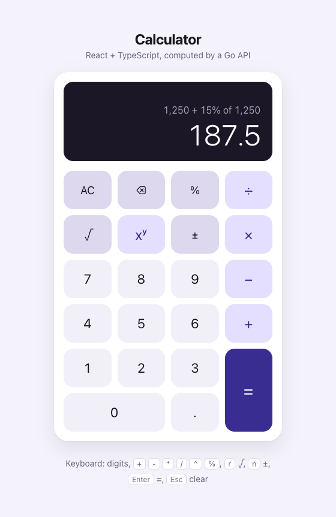

# Full-Stack Calculator

A calculator with a **React + TypeScript** frontend and a **Go** REST microservice. Every arithmetic operation is performed by the backend; the frontend owns input, presentation and error handling.

<p align="center"></p>

| | |
|---|---|
| **Operations** | add, subtract, multiply, divide, power, square root, percentage |
| **Backend** | Go 1.24+, standard library only (`net/http`, `encoding/json`, `log/slog`) — zero third-party dependencies |
| **Frontend** | React 19, TypeScript (strict), Vite, plain CSS (light/dark, mobile-first) |
| **Tests** | Go `testing` (table-driven, `-race`) · Vitest + Testing Library — **100%** domain / **99%** HTTP layer / **97%** frontend statements |
| **Delivery** | Single Docker image (Go serves the built SPA) · GitHub Actions CI incl. Docker smoke test |

---

## Contents

1. [Quick start](#quick-start)
2. [Project structure](#project-structure)
3. [API reference](#api-reference)
4. [Using the calculator](#using-the-calculator)
5. [Testing & coverage](#testing--coverage)
6. [Design decisions](#design-decisions)
7. [Assumptions & trade-offs](#assumptions--trade-offs)
8. [AI usage](#ai-usage)

---

## Quick start

### Prerequisites

- **Go** 1.24+
- **Node.js** 20.19+ or 22.12+ (required by Vite) and npm
- *Optional:* Docker, `make`

### Option A — Docker (one command)

```bash
docker build -t fullstack-calculator .
docker run --rm -p 8080:8080 fullstack-calculator
# open http://localhost:8080
```

The image is multi-stage: Node builds the frontend, Go builds a static binary, and the runtime is `distroless/static` running as non-root. The Go server serves both the API and the SPA, so there is no CORS in production.

### Option B — Run locally (two terminals)

```bash
# Terminal 1 — backend on http://localhost:8080
cd backend
go run ./cmd/server

# Terminal 2 — frontend on http://localhost:5173
cd frontend
npm ci
npm run dev
```

Open **http://localhost:5173**. The Vite dev server proxies `/api/*` to `:8080`, so the browser talks to a single origin.

With `make` installed, the equivalents are `make run-backend`, `make install && make run-frontend`, `make test`, `make coverage`, `make lint` and `make docker-run` (`make help` lists everything).

### Configuration

| Variable | Where | Default | Purpose |
|---|---|---|---|
| `PORT` | backend | `8080` | HTTP listen port |
| `ALLOWED_ORIGINS` | backend | `http://localhost:5173` | Comma-separated CORS allow-list (`*` allows any) |
| `STATIC_DIR` | backend | *(unset)* | If set, serves the built SPA from this directory (used by the Docker image) |
| `VITE_API_BASE_URL` | frontend (build time) | *(empty = same origin)* | Point the UI at a backend on another origin, e.g. `http://localhost:8080` |
| `API_PROXY_TARGET` | frontend (dev server) | `http://localhost:8080` | Where the dev proxy forwards `/api` |

---

## Project structure

```
.
├── backend/
│   ├── cmd/server/          # main: config, wiring, graceful shutdown
│   └── internal/
│       ├── calculator/      # pure domain: operation registry, validation, typed errors
│       ├── httpapi/         # handlers, JSON encoding, error mapping, middleware, SPA serving
│       └── config/          # env-based configuration
├── frontend/
│   └── src/
│       ├── api/             # typed API client (timeout, error mapping)
│       └── features/calculator/
│           ├── calculatorReducer.ts   # pure state machine
│           ├── useCalculator.ts       # runs API calls requested by the reducer
│           ├── format.ts / keymap.ts / errorMessages.ts
│           └── components/            # Calculator, Display, Keypad
├── docs/coverage/           # committed coverage summaries
├── Dockerfile               # full-stack image
├── Makefile
└── .github/workflows/ci.yml
```

Dependencies point inwards: `httpapi → calculator`, never the reverse. The domain package knows nothing about HTTP or JSON, and the UI components know nothing about `fetch`.

---

## API reference

Base path: `/api/v1`. All bodies are JSON.

| Method | Path | Body | Description |
|---|---|---|---|
| `POST` | `/api/v1/add` | `{"a": number, "b": number}` | a + b |
| `POST` | `/api/v1/subtract` | `{"a": number, "b": number}` | a − b |
| `POST` | `/api/v1/multiply` | `{"a": number, "b": number}` | a × b |
| `POST` | `/api/v1/divide` | `{"a": number, "b": number}` | a ÷ b |
| `POST` | `/api/v1/power` | `{"a": number, "b": number}` | a raised to b |
| `POST` | `/api/v1/percentage` | `{"a": number, "b": number}` | a percent of b (a × b / 100) |
| `POST` | `/api/v1/sqrt` | `{"a": number}` | √a |
| `GET` | `/api/v1/operations` | — | Lists supported operations with arity and symbol |
| `GET` | `/healthz` | — | Liveness probe |

### Examples

```bash
curl -s -X POST localhost:8080/api/v1/add -H 'Content-Type: application/json' -d '{"a": 0.1, "b": 0.2}'
# 200 {"operation":"add","operands":[0.1,0.2],"result":0.3}

curl -s -X POST localhost:8080/api/v1/power -H 'Content-Type: application/json' -d '{"a": 2, "b": 10}'
# 200 {"operation":"power","operands":[2,10],"result":1024}

curl -s -X POST localhost:8080/api/v1/sqrt -H 'Content-Type: application/json' -d '{"a": 81}'
# 200 {"operation":"sqrt","operands":[81],"result":9}

curl -s -X POST localhost:8080/api/v1/percentage -H 'Content-Type: application/json' -d '{"a": 15, "b": 200}'
# 200 {"operation":"percentage","operands":[15,200],"result":30}
```

### Errors

Every error has the same shape, with a stable machine-readable `code` and a human-readable `message`:

```bash
curl -s -X POST localhost:8080/api/v1/divide -H 'Content-Type: application/json' -d '{"a": 1, "b": 0}'
# 422 {"error":{"code":"DIVISION_BY_ZERO","message":"Division by zero is not allowed."}}

curl -s -X POST localhost:8080/api/v1/add -H 'Content-Type: application/json' -d '{"a": "1", "b": 2}'
# 400 {"error":{"code":"INVALID_OPERAND","message":"Operand \"a\" must be a finite number."}}
```

| Status | Code | When |
|---|---|---|
| 400 | `INVALID_JSON` | Empty/malformed body, unknown fields, trailing data, non-object body |
| 400 | `INVALID_OPERAND` | Operand is not a number or exceeds float64 range (e.g. `1e400`) |
| 400 | `MISSING_OPERAND` | `a` (or `b` for binary operations) is missing or `null` |
| 400 | `UNEXPECTED_OPERAND` | `b` sent to a unary operation (`sqrt`) |
| 404 | `UNKNOWN_OPERATION` | e.g. `POST /api/v1/modulo` |
| 404 | `NOT_FOUND` | Any other unknown `/api/*` route |
| 413 | `PAYLOAD_TOO_LARGE` | Body over 1 KiB |
| 422 | `DIVISION_BY_ZERO` | `x / 0`, and `0 ^ negative` (which is `1 / 0ⁿ`) |
| 422 | `NEGATIVE_SQUARE_ROOT` | `sqrt` of a negative number |
| 422 | `UNDEFINED_RESULT` | No real result, e.g. `(-8) ^ 0.5` |
| 422 | `RESULT_OUT_OF_RANGE` | Result overflows float64, e.g. `10 ^ 400` |
| 500 | `INTERNAL_ERROR` | Unexpected failure (panics are recovered and logged) |

**400 vs 422:** 400 means the request itself is malformed; 422 means it is well-formed but mathematically invalid. This lets clients tell "fix your payload" apart from "valid input that has no answer".

---

## Using the calculator

The calculator uses **immediate execution**, the same model as a pocket or phone calculator: `2 + 3 × 4 =` evaluates left to right to **20**. Each step is one API call.

| Input | Result | Notes |
|---|---|---|
| `12 + 3 =` | 15 | |
| `2 + 3 × 4 =` | 20 | `×` first computes `2 + 3` |
| `5 + =` | 10 | The shown value is reused as the right operand |
| `9 √` | 3 | Unary operations apply to the shown value |
| `200 + 10 %` → `=` | 20 → 220 | After `+`/`−`, `%` means "percent of the left operand" |
| `50 %` | 0.5 | Otherwise, `%` converts to a fraction |
| `7 ÷ 0 =` | "Cannot divide by zero" | Typing a digit or pressing AC recovers |

**Keyboard:** digits, `.` / `,`, `+ - * / ^`, `%`, `r` (√), `n` (±), `Enter` / `=`, `Backspace`, `Esc` / `Delete` / `c` (clear).

**Input validation in the UI:** at most one decimal point, leading zeros are normalized, entry is capped at 15 digits (the precision float64 guarantees), and input is ignored while a request is in flight. Backend and network errors become short messages that fit the display.

---

## Testing & coverage

```bash
cd backend  && go test -race -cover ./...      # backend
cd frontend && npm run test:coverage           # frontend
make coverage                                  # both, written to docs/coverage/
```

Current results (full reports in [`docs/coverage/`](docs/coverage)):

| Layer | Package / area | Statements |
|---|---|---|
| Backend | `internal/calculator` | 100% |
| Backend | `internal/config` | 100% |
| Backend | `internal/httpapi` | 99.1% |
| Backend | `cmd/server` *(process lifecycle only)* | partial |
| Frontend | all files | 97.0% statements · 96.2% branches · 99.4% lines |

**What is tested:**

- **Domain:** every operation, including edge cases: division by zero, `0^-1`, negative square root, `(-8)^0.5`, overflow, NaN/Inf inputs, negative-zero normalization and float-artifact rounding.
- **HTTP:** success responses for each endpoint and every error code: malformed/empty/oversized bodies, unknown fields, type errors, arity violations, unknown routes. Also CORS preflight, panic recovery, request logging and SPA fallback.
- **Reducer:** number entry, chaining, operator replacement, unary operations, percent semantics, sign toggling, stale-response handling and error recovery. These are pure function tests with no React involved.
- **API client:** request shape, server error mapping, malformed responses, network failure, timeout (fake timers) and caller cancellation.
- **UI integration:** user flows through `@testing-library/user-event` (mouse and keyboard) against a fake API, error display, request abort on clear and late responses being ignored.

CI (`.github/workflows/ci.yml`) runs gofmt, `go vet`, race-enabled tests, oxlint, `tsc`, Vitest with coverage and a production build. It then builds the Docker image and smoke-tests the running container (health, SPA, a calculation and a 422).

---

## Design decisions

### Backend

- **Standard library only.** Go 1.22+ `ServeMux` supports method and path-parameter routing (`POST /api/v1/{operation}`), so a router framework would add a dependency without adding value here. `log/slog` provides structured logs.
- **Operation registry.** Each operation is declared once with its name, symbol, arity and implementation. The single generic handler looks up the operation, validates operands against its arity and delegates. Adding an operation means adding one line plus its function; `GET /api/v1/operations` is derived from the same source.
- **One endpoint per operation** (`/api/v1/add`) rather than `/calculate?op=add`. URLs are self-describing, an unknown operation is naturally a 404, and per-operation metrics or rate limits would be straightforward to add.
- **Domain errors stay separate from transport errors.** The `calculator` package returns sentinel errors (`ErrDivisionByZero`, …). `httpapi` maps them to status codes and stable error codes in one place, so the domain stays reusable (for example from a CLI or gRPC service) and the mapping is easy to audit.
- **Strict input decoding.** Pointer fields tell a missing operand apart from `0`. `DisallowUnknownFields`, a single-object check, a 1 KiB `MaxBytesReader` and typed error messages make invalid input fail loudly instead of being silently coerced.
- **Results are always finite JSON numbers.** NaN and ±Inf can't be encoded in JSON, so they are turned into explicit 422 errors, and `-0` is normalized to `0`.
- **Floating-point presentation.** Results are rounded to **15 significant digits**, the precision float64 round-trips reliably. This turns `0.1 + 0.2` into `0.3` instead of `0.30000000000000004`. For real money math I would use a decimal type (e.g. `shopspring/decimal`) or integer minor units, as discussed under trade-offs.
- **Operational basics:** server timeouts (including `ReadHeaderTimeout` against slowloris), graceful shutdown on SIGTERM, panic recovery, a CORS allow-list and a health endpoint.

### Frontend

- **A pure reducer that describes side effects as data** (an MVI-style approach). The reducer never calls the network. When a computation is needed, it stores a `pending` record holding the request and what to do with the result (`equals`, `chain` with the next operator, or `replaceEntry`). `useCalculator` runs that request and dispatches `resolved` or `failed`. As a result:
  - every calculator rule is a synchronous, deterministic, easily tested state transition;
  - request ids make stale responses harmless, and clearing aborts the in-flight `fetch` through `AbortController`;
  - input is ignored while a request is pending, so ordering is always deterministic.
- **Dependency injection over module mocking.** `<Calculator api={…} />` receives a `CalculatorApi` interface, so tests pass a fake instead of patching `fetch` globally.
- **A typed client with explicit failure modes:** server error codes are preserved, and network, timeout and malformed responses each get their own client-side code. The UI maps codes to short messages that fit the display.
- **Accessibility and responsiveness:** real `<button>`s with ARIA labels, an `aria-live` result, `aria-pressed` on the active operator, visible focus rings, keyboard support, `prefers-color-scheme` and `prefers-reduced-motion` support, ≥56 px touch targets and safe-area insets. The loading bar appears only after 150 ms, so fast responses never flicker.
- **No UI library.** A calculator needs about 250 lines of CSS. Avoiding Tailwind or a component kit keeps the bundle small (~72 KB gzipped JS, mostly React) and the markup readable.

---

## Assumptions & trade-offs

- **Percentage is a binary operation** in the API (`a% of b`) because it is the most general form. The UI derives the familiar calculator behavior from it (`200 + 10%` → 20, `50%` → 0.5).
- **Unary minus is input editing, not an API call.** `±` only changes the typed number. Every *arithmetic* operation goes through the backend, as the brief asks.
- **No operator precedence.** Immediate execution matches how handheld calculators work. An expression-parsing endpoint (`POST /api/v1/evaluate` with `"2+3*4"`) would be the natural extension if precedence were required.
- **One HTTP round-trip per step.** This fits the brief ("the frontend should consume the backend API"). In a real product, basic arithmetic would usually run client-side, with the server used where its result must be authoritative.
- **float64, not decimal.** The 15-significant-digit rounding fixes display artifacts but is not exact decimal arithmetic. In a payments context I would represent amounts as integer minor units or use an arbitrary-precision decimal type, and define rounding modes explicitly.
- **Not in scope (but next steps in production):** authentication and rate limiting, request IDs and tracing, OpenAPI spec generation, metrics (Prometheus), a calculation history, i18n number formatting and E2E tests (Playwright) against the Docker image.

---

## AI usage

The assignment allows any AI tooling. I used **Claude Code** (Anthropic's CLI agent) as a pair programmer for scaffolding, tests and documentation. I reviewed, ran and adjusted all of the output. The prompts are listed in [PROMPTS.md](PROMPTS.md).
